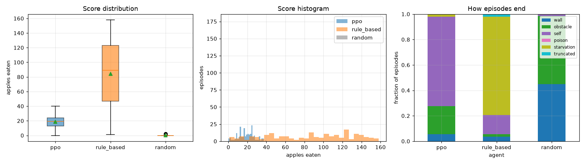

# Smart Snake: a game environment for Deep Reinforcement Learning

Smart Snake is a Snake-like grid game with **interactive** (pygame) and **headless** (Gymnasium) modes.
The project includes a **PPO agent with a custom neural network** (Stable-Baselines3), a
**rule-based baseline agent**, and an evaluation pipeline that compares them.


*(figure generated by `evaluate.ipynb`)*

---

## 1. The game

The snake moves on a 12×12 board. Each apple adds one segment and one point. The snake dies if it hits a
wall, an obstacle or its own body.

### Original contributions (compared with classic Snake)
| Mechanic | Description | Why it makes the problem harder or more interesting |
|---|---|---|
| **Random obstacles** | 4 short wall segments (1–3 cells) are generated each episode. The free board is guaranteed to stay connected (flood fill). | The agent can't memorise one layout, so it has to generalise across layouts. |
| **Moving poison apple** | Eating the purple apple shrinks the snake by one segment (−5 reward). It jumps to a new cell every 40 steps. If the snake drops below 2 segments, it dies. | Adds a hazard that changes position over time. |
| **Hunger** | The snake starves after 150 steps without eating. A HUD "energy" bar shows how much time is left. | Prevents endless safe loops, so there's a real trade-off between safety and progress. |
| **Speed-up (human mode)** | The game speeds up as the score increases. | Raises the difficulty for human players. |

### Inspiration / references
* Snake game concept: *Blockade* (Gremlin, 1976) and Nokia *Snake* (1997). See https://en.wikipedia.org/wiki/Snake_(video_game_genre)
* Schulman et al., *Proximal Policy Optimization Algorithms*, 2017. https://arxiv.org/abs/1707.06347
* Raffin et al., *Stable-Baselines3: Reliable RL Implementations*, JMLR 2021. https://github.com/DLR-RM/stable-baselines3
* Towers et al., *Gymnasium*, 2024. https://gymnasium.farama.org
* SB3 custom policy guide: https://stable-baselines3.readthedocs.io/en/master/guide/custom_policy.html

---

## 2. RL formulation (MDP)

| Element | Definition |
|---|---|
| **State / observation** | `Dict` with two parts. `grid` is a float32 tensor of shape 5×14×14 (the board plus a 1-cell wall border). Its channels are head, body (1.0 at the neck, decreasing to the tail so the order is encoded), apple, poison, and walls + obstacles. `features` is a float32 vector of 14 values: danger straight/right/left, heading one-hot (4), apple dx/dy, nearest poison dx/dy, hunger ratio, length ratio, and "poison straight ahead". |
| **Actions** | `Discrete(3)`, relative to the heading: 0 = straight, 1 = turn right, 2 = turn left. Relative actions make the 180° suicide move impossible. |
| **Reward** | +10 apple · −5 poison · −10 death (any cause, including starvation) · +50 board cleared · −0.01 per step · +0.1 when the snake moves closer to the apple and −0.1 when it moves away (Manhattan distance shaping). |
| **Termination** | Death (wall, obstacle, self, poison, starvation) or win. **Truncation** at 5,000 steps (safety cap). |
| **Discount** | γ = 0.99 |

All values are defined in [snake_rl/config.py](snake_rl/config.py).

## 3. RL algorithm and network

**Algorithm:** PPO (on-policy actor-critic with a clipped surrogate objective). We chose it because:
* it's stable and has few sensitive hyperparameters, and it works well with discrete actions;
* it uses parallel environments efficiently (8 envs);
* its entropy bonus helps exploration in a sparse-reward game.

**Custom network** ([snake_rl/networks.py](snake_rl/networks.py)). This is not an SB3 default policy:

```
grid 5x14x14 ─ Conv3x3(32) ─ Conv3x3(64, s2) ─ Conv3x3(64) ─ Flatten ─ Linear(128) ─ LayerNorm ┐
features 14  ─ Linear(64) ─ Linear(64) ────────────────────────────────────────────────────────┤
features 14  ─ (skip connection) ──────────────────────────────────────────────────────────────┴─ concat(206)
        ├─ actor : Linear(128) ─ Linear(64) ─ 3 logits
        └─ critic: Linear(128) ─ Linear(64) ─ V(s)            (all activations ReLU)
```
Design choices, each checked with short diagnostic runs:
* **Egocentric grid.** The board image is rotated so the snake always faces up, which matches the relative
  action space. With absolute coordinates, PPO had not learned to eat after 100k steps.
* **Small CNN.** The board is tiny, so the CNN keeps full resolution in its first layer and then strides once
  (SB3's NatureCNN needs ≥36×36 inputs).
* **LayerNorm and skip connection.** In the first version, a 256-dim CNN embedding that was still noise early in
  training drowned out the informative vector features, and learning was much slower than with the features
  alone. The LayerNorm keeps both branches on the same scale, and the skip connection passes the raw features
  directly to the heads.

| Hyperparameter | Value | Reason |
|---|---|---|
| total timesteps | 3,000,000 | enough to reach a plateau of the sliding-average reward |
| n_envs × n_steps | 8 × 512 = 4096 / update | less gradient variance |
| batch size / epochs | 512 / 4 | standard PPO values |
| learning rate | 3e-4, linearly decayed to 0 | stabilises the end of training |
| γ / GAE λ | 0.99 / 0.95 | episodes are long, so the agent needs to plan ahead |
| clip range | 0.2 | PPO default |
| entropy coef. | 0.01 | keeps exploring |

## 4. Rule-based agent

The rule-based agent is in [snake_rl/rule_agent.py](snake_rl/rule_agent.py). It reads the full game state and
returns the same relative action as the RL agent. Its priority rules:
1. **Safe shortest path to the apple.** Run a BFS that avoids walls, obstacles, poison and body. Then simulate the
   path on a virtual snake and accept it only if the tail is still reachable after eating, so the snake
   doesn't trap itself.
2. **Follow the tail** when no safe apple path exists. The tail keeps freeing cells, which buys time.
3. **Maximise free space.** Pick the non-fatal move with the largest flood-fill area, and penalise poison.
4. Otherwise go straight (every move is fatal).

---

## 5. Setup

Requirements: [uv](https://docs.astral.sh/uv/) and Python 3.10–3.13.

```bash
uv sync                 # creates .venv from pyproject.toml + uv.lock
```

## 6. How to run

| Command | What it does |
|---|---|
| `uv run play.py` | **Interactive mode**: play yourself (arrows/WASD, `P` pause, `R` restart, `Esc` quit) |
| `uv run train.py` | Train PPO headless (default 3M steps, about 1 h on CPU). Options: `--timesteps`, `--n-envs`, `--subproc`, `--run-name`, `--device` |
| `uv run tensorboard --logdir logs` | Watch convergence (`episode/total_reward`, `episode/avg_reward_100`, `rollout/ep_rew_mean`, …) |
| `uv run test.py` | Evaluate PPO, the rule-based agent and a random baseline on 200 identical seeded episodes, and write CSVs |
| `uv run observe.py --agent rl` | Watch one episode of the trained agent (`--agent rule` for the baseline, `--seed`, `--fps`, `--gif out.gif`) |
| `uv run jupyter notebook evaluate.ipynb` | Plots and tables (training convergence + agent comparison) |

Typical pipeline: `uv sync` → `uv run train.py --subproc` → `uv run test.py` → open `evaluate.ipynb`.

## 7. Project structure

```
smart_snake/
├── pyproject.toml, uv.lock     uv project (reproducible with `uv sync`)
├── train.py                    trains the PPO agent (headless)
├── test.py                     evaluates the PPO + rule-based (+ random) agents and writes CSV files
├── play.py                     human play (interactive mode)
├── observe.py                  watch one episode of an agent (interactive mode)
├── evaluate.ipynb              convergence plots, comparison tables and plots
├── snake_rl/
│   ├── config.py               game rules, reward function, env settings
│   ├── game.py                 pure game logic (no rendering)
│   ├── env.py                  Gymnasium env (observation, actions, reward); headless unless render_mode is set
│   ├── renderer.py             pygame graphics
│   ├── rule_agent.py           rule-based baseline agent
│   ├── networks.py             custom feature extractor + actor/critic architecture
│   ├── callbacks.py            logs each episode's total reward to TensorBoard + CSV
│   └── evaluation.py           shared evaluation loop and metrics
├── models/ppo_snake/           best_model.zip, final_model.zip, checkpoints/, config.json
├── logs/ppo_snake/             TensorBoard logs (ppo_1/, episodes/), episodes.csv, eval/evaluations.npz
└── results/                    eval_episodes.csv, eval_summary.csv, figures/*.png
```

## 8. Evaluation metrics

| Metric | Why |
|---|---|
| Score mean / median / max (+95% CI) | the game objective, independent of reward shaping |
| Total reward | the quantity the RL agent optimises |
| Steps per apple | efficiency |
| Success rate (score ≥ 10) | robustness against early failures |
| Death-cause distribution | shows *how* each agent fails |
| Poison eaten per episode | how well the agent avoids hazards |
| Decision time per action | computational cost |

## 9. Working environment (used for the reference run)

* Intel Core i7-9750H (6C/12T), 16 GB RAM, NVIDIA GTX 1660 Ti (unused: training ran on the CPU), Windows 11
* Python 3.13.14, torch 2.15.0 (CPU build), stable-baselines3 2.9.2, gymnasium 1.4.0, pygame 2.6.1,
  numpy 2.5.4, pandas 3.1.1, matplotlib 3.11.2, tensorboard 2.21.0, uv 0.13.7
